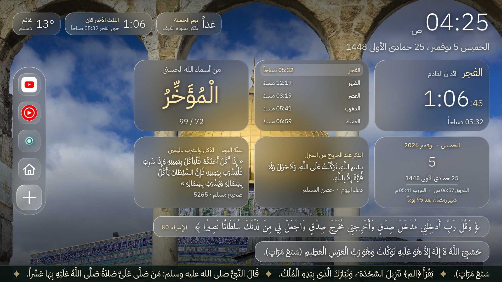
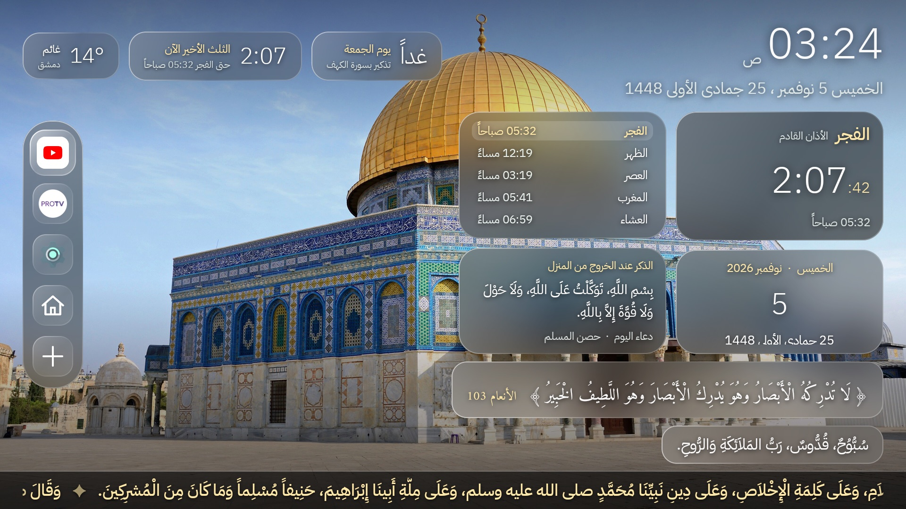
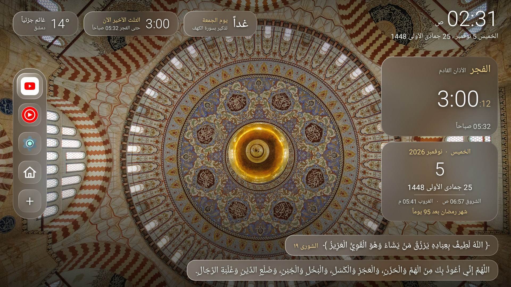
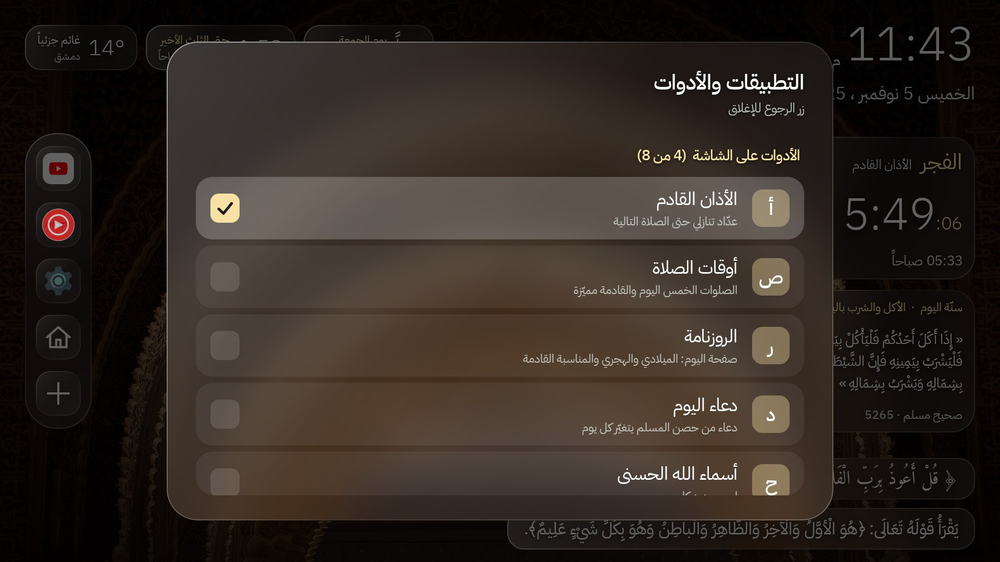

# Islamic Android TV Launcher

A calm, Arabic-first home screen for Android TV / Google TV. It replaces the stock launcher with a "liquid glass" dashboard
of prayer times, the next adhan, Hijri date, a daily ayah and dhikr, a scrolling azkar bar and rotating photos of historic
mosques. Built with Kotlin and Jetpack Compose, designed for the remote (D-pad) and for RTL.



| | |
|---|---|
|  |  |

## Customize with the + button

Press **+** on the app rail to open the selector: toggle each widget, the ayah / dhikr cards and extra apps with the remote.



## Features

- **Prayer times that work offline**: a full-year timetable is bundled, and refreshed every 10 days from the mosque's
  Mawaqit page (validated, with typo repair). [adhan-java](https://github.com/batoulapps/adhan-java) is the last-resort fallback.
- **Adhan**: exact alarm for the next prayer, pauses other apps (including a playing YouTube video), plays the adhan and shows a
  liquid-glass reminder card. Skipped when the screen is off. OK / Back dismisses it. A tick box in the **+** list ("تنبيه الأذان")
  switches the whole adhan on or off.
- **Widgets**: next prayer + countdown, all five prayers, Gregorian + Hijri date, names of Allah, sunnah and dua (a new one
  every 6 hours, from an offline library large enough to go weeks without repeating). Optional ayah and dhikr cards. Smart chips for Friday (Surat al-Kahf) and the last third of the night.
- **Azkar news bar** along the bottom (morning / evening schedule) and a rotating ayah.
- **Photos**: bundled photos of historic mosques (no people), changing every 30 s with blurred "glass" panels. When the TV is on
  a home network the app also finds and downloads more **4K** mosque photos at run time, see
  [Online background photos](#online-background-photos).
- **App rail** on the left: YouTube, Settings and your own picks. The **+** tile opens a list where you switch widgets on or off and add apps.
- **Trusted clock**: TVs without a battery-backed clock show a wrong date after an offline boot; the launcher keeps correct time
  (and correct prayer days) anyway, then follows the network clock again as soon as it is available.
- **App name and icon**: "Islamic Tv Launcher" (Arabic: "التلفاز الإسلامي"), a flat mosque-inside-a-TV icon and TV banner.
- Fonts: IBM Plex Sans Arabic and Amiri Quran.

## Online background photos

After the bundled photos have been shown, the launcher shows extra **4K** mosque / Islamic-architecture photos that it found and
downloaded itself from [Wikimedia Commons](https://commons.wikimedia.org). Nothing extra is bundled in the APK.

**When it runs**
- A cycle is: every bundled photo once (shuffled), then every downloaded photo once, then it starts again.
- Downloading only begins when **5 or fewer bundled photos of the current cycle are still unseen**, so a freshly started launcher
  does not touch the network at all.
- One photo at most every 45 seconds, in the background (never on the UI thread), the 3840 px wide version only (never the
  8K originals), 20 MB cap per file, HTTPS only.

**How much data it may use** (search pages and photos both count, reset every day)

| Connection | Daily limit |
|---|---|
| Home Wi-Fi / Ethernet | 500 MB |
| Mobile data or a **phone hotspot** (Android marks both as metered) | 100 MB |
| No internet | nothing is requested |

A TV connected to a phone's hotspot counts as metered, so a hotspot can never use more than 100 MB a day for this.

**Which photos are accepted** (same rules as the bundled photos), checked in this order
1. Search is done by Commons itself with a size filter (`filew`/`fileh` at least 3840x2160, JPEG only); the downloaded file is
   checked again after download.
2. Must carry a Commons **Quality / Featured / Valued** mark ("well-photographed").
3. Title, description and categories must name a mosque or Islamic architecture and must **not** mention people (worshippers,
   tourists, prayer, crowds ...), Shia / Iran / Iraq sites, shrines, tombs or other religions.
4. After download, an on-device **face check** throws the photo away if a face is found.
Rules live in `ui/background/OnlineRules.kt` and are unit-tested, including against a real Commons result sample.

**Offline.** Up to 40 photos are kept in the app's private storage and keep working with no internet; once a day the oldest one is
replaced so new ones keep arriving. Any failure (no network, full disk, bad file) is caught and retried later; it can never stop the
rotation or crash the launcher.

## Build

Requirements: Android Studio (or JDK 17 + Android SDK), `adb`.

```sh
./gradlew :app:testDebugUnitTest
./gradlew :app:assembleRelease     # app/build/outputs/apk/release/app-release.apk
```

Judge performance on the **release** build only; debug is much slower.

## Install on a TV

1. TV: Settings > System > About > tap *Build* 7 times, then Developer options > USB debugging ON. Note the TV IP.
2. From a computer on the same Wi-Fi, run one command:

```sh
tools/install.sh TV_IP
```

It installs the app (your local release build, or the latest GitHub release if you have not built one), grants the two
permissions the adhan needs, **makes the Home button open the launcher** (whatever stock home the TV has) and checks
that it worked.
Accept the *Allow USB debugging* box on the TV the first time. Undo with `tools/install.sh --undo TV_IP`.

> **Installing the APK alone is not enough.** The stock Google TV home outranks any installed app, so until it is switched
> off the Home button keeps opening Google TV. The script does this for you; if you install by hand (or you are an AI
> agent doing the install), the [Home button step](#the-home-button-step-by-hand) is part of the install, not an extra.

<details>
<summary>The same steps by hand (Windows, or if you prefer)</summary>

```sh
adb connect TV_IP:5555
adb install -r app/build/outputs/apk/release/app-release.apk
adb shell appops set com.khaled.tvlauncher SYSTEM_ALERT_WINDOW allow
adb shell appops set com.khaled.tvlauncher SCHEDULE_EXACT_ALARM allow
```

Without those two permissions the adhan reminder card and exact alarms won't work. Then do the
[Home button step](#the-home-button-step-by-hand) and open the app once so the alarm is armed.

</details>

### Install without adb (no developer mode, no USB debugging)

You only need developer options and USB debugging for the `adb` route above. To sideload on the TV itself:

1. Copy `app-release.apk` to a USB stick, or download it on the TV (browser, or an app such as *Send Files to TV*).
2. Open it with a file manager app on the TV (for example *X-plore* or *File Commander*).
3. When Android asks, allow installing from unknown sources for that file manager
   (Settings > Apps > Special app access > Install unknown apps). This is not developer mode.
4. Tap *Install*, then open the app once so the first azan alarm is armed.
5. Grant the permissions by hand (Settings > Apps > Special app access):
   - **Display over other apps** for the azan reminder card and for coming to the front when the TV wakes up.
   - **Alarms & reminders** for exact azan times. Without it the azan still fires, possibly a little late.

Without adb the launcher is opened from the app list: the **Home button** keeps opening Google TV, because switching the
stock home off is something only `adb` can do (see below).

Release builds are signed with the debug key, so a later build from another machine will not install over it:
uninstall first (this clears your widget choices).

### The Home button step by hand

`tools/install.sh` already does this, on any TV: it asks Android which app owns Home and, while that is not the launcher,
switches that app off and asks again. No package names are assumed; Settings and system packages are never touched, and
every app it switches off is recorded on the TV so `--undo` restores exactly those.

By hand it is the same loop. Ask who owns Home:

```sh
adb shell cmd package resolve-activity --brief -a android.intent.action.MAIN -c android.intent.category.HOME
```

If the last line does not start with `com.khaled.tvlauncher`, switch that package off and take the role, then ask again:

```sh
adb shell pm disable-user --user 0 THAT_PACKAGE
adb shell cmd role add-role-holder --user 0 android.app.role.HOME com.khaled.tvlauncher
```

On a TCL "Smart TV Pro" (Google TV, Android 12, the only TV tested so far) the packages are
`com.google.android.apps.tv.launcherx` and then `com.google.android.tungsten.setupwraith`. Never disable `android`,
Settings or System UI.

Undo: `tools/install.sh --undo TV_IP`, or `adb shell pm enable <package>` for each one. Do this **before** uninstalling
the launcher, so the TV is not left without a home screen.
Use at your own risk on other TVs. See [`tools/reclaim-home.sh`](tools/reclaim-home.sh).

## Location

Prayer times, weather and schedules currently target **Damascus**. Other cities need a few constants changed, see
[docs/ARCHITECTURE.md](docs/ARCHITECTURE.md#location). Making this configurable is a great first contribution.

## Project layout

- `app/src/main/java/com/khaled/tvlauncher/`: one package per feature: `time`, `prayer`, `azan`, `content`, `widgets`, `weather`,
  `youtube`, `apps`, and `ui/{home,widgets,background,theme}` (`ui/background` also holds the online-photo search, rules, network guard and downloader). See the layout in [`docs/ARCHITECTURE.md`](docs/ARCHITECTURE.md).
- `gradle/libs.versions.toml`: all dependency and plugin versions (version catalog).
- `app/src/main/assets/`: `ayat.json`, `azkar.json`, `duas.json`, `sunnah.json`, `asma.json`, background photos.
- [`docs/ARCHITECTURE.md`](docs/ARCHITECTURE.md): how the pieces fit together.
- `tools/build_content.py`: regenerates the ayat / azkar JSON from open datasets.

## Contributing

Pull requests are welcome, see [CONTRIBUTING.md](CONTRIBUTING.md). `main` is protected: every change goes through a PR
that the maintainer reviews before merge. Corrections to Arabic text (ayat, azkar, duas, hadith) are especially valued,
please cite the source.

## Credits

- Photos: Wikimedia Commons, individual authors and licences in [`app/src/main/assets/bg/CREDITS.txt`](app/src/main/assets/bg/CREDITS.txt) (CC BY / CC BY-SA / CC0).
- Quran text: [Tanzil Project](https://tanzil.net). Azkar: Hisn al-Muslim dataset, [rn0x/Adhkar-json](https://github.com/rn0x/Adhkar-json).
- Fonts: IBM Plex Sans Arabic and Amiri Quran, SIL OFL 1.1 (`app/src/main/assets/licenses/`).
- Prayer timetable: the Umayyad Mosque (Damascus) published timetable on [Mawaqit](https://mawaqit.net).
- If you own any asset and want it removed or credited, please open an issue.

## License

Source code: [MIT](LICENSE). Third-party assets keep their own licences (see Credits).
